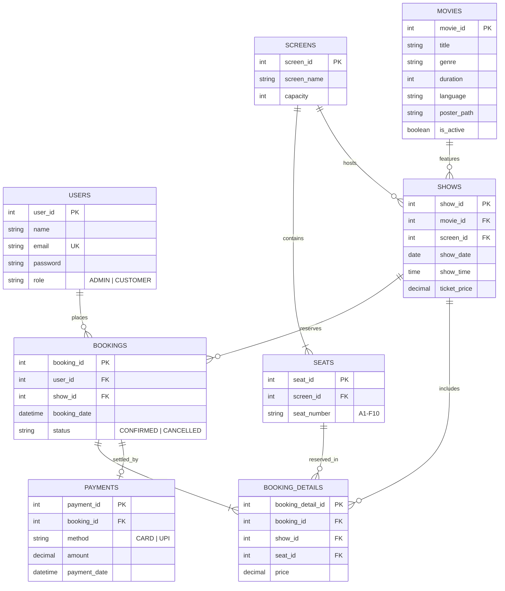
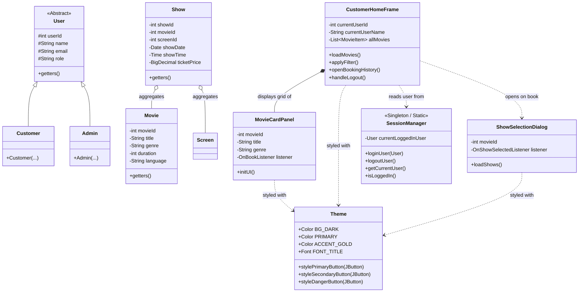

# 📐 Cinema Management System — Architecture & Diagrams
*Prepared by Nanditha P V (Master Integration & QA Lead)*

---

## 1. 🗄️ Entity-Relationship (ER) Diagram

---

## 2. 🧩 High-Level Class Diagram (MVC Structure)

---

## 3. 🎓 Viva Questions & Answers for Nanditha (Member 6)

### Q1: What was your specific architectural role in this project?
> **Answer:** "I served as the **Customer Portal, Master Integration & QA Lead**. My role was twofold:
> 1. **User Experience:** Building the entire customer storefront (`CustomerHomeFrame`), reusable components (`MovieCardPanel`), and the show selector modal (`ShowSelectionDialog`).
> 2. **System Integration & Architecture:** Establishing the shared UI design language (`Theme.java`), enforcing clean MVC boundaries, preventing tight coupling between the views and database queries, and leading end-to-end integration across all 6 modules."

### Q2: How does your module demonstrate "Loose Coupling and High Cohesion"?
> **Answer:**
> * **High Cohesion:** Every class has a single, sharply focused responsibility:
>   * `Theme`: Responsible solely for visual design tokens and component styling.
>   * `MovieCardPanel`: Encapsulates purely the visual representation of a single movie card and fires an event callback when clicked.
>   * `ShowSelectionDialog`: Manages only the workflow of presenting showtimes and capturing customer selection.
>   * `CustomerHomeFrame`: Manages the overall customer dashboard layout, filtering, and navigation.
> * **Loose Coupling:** The UI components do not execute SQL queries or hold database connection handles. Communication occurs via data transfer objects (`MovieItem` / `Movie`, `Show`) and event listener interfaces (`OnBookListener`, `OnShowSelectedListener`). This guarantees that modifications to the database layer or backend business logic do not break the presentation layer.

### Q3: What is the benefit of the ShowSelectionDialog you built?
> **Answer:** "In cinema booking workflows, customers don't book a 'movie' directly—they book a **specific show** at a specific theater screen, date, and time. `ShowSelectionDialog` acts as the vital bridge between browsing the movie catalog and selecting physical seats in Shada's seat matrix."
