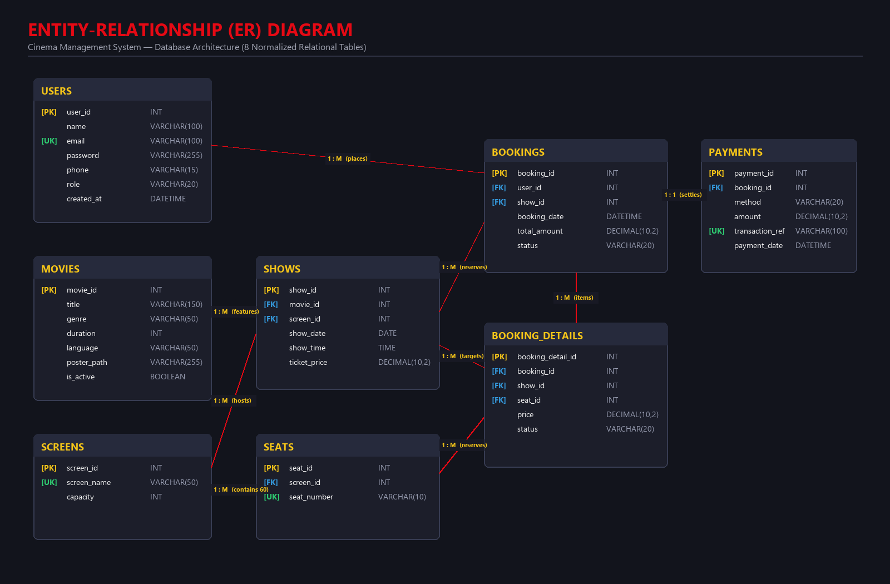
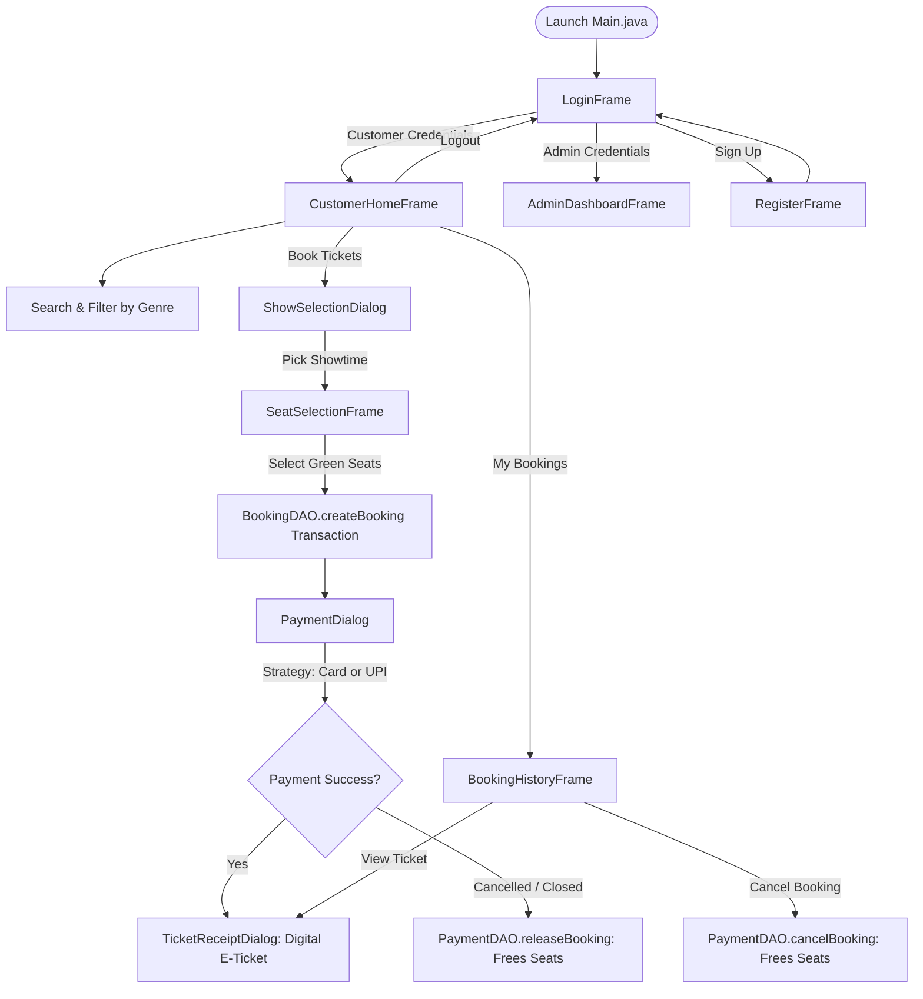

# 🎬 Cinema Management System — Final Project Report
**Subject:** Object-Oriented Programming (OOP) Microproject in Java  
**Architecture:** 3-Tier Model-View-Controller (MVC) with JDBC & MySQL  
**Integration & QA Lead:** Nanditha P V (Member 6)  
**Date of Submission:** October 2026  

---

## 📑 Table of Contents
1. [Executive Summary & Project Overview](#1-executive-summary--project-overview)
2. [Team Roster & OOP Concepts Distribution](#2-team-roster--oop-concepts-distribution)
3. [System Architecture & Design Patterns](#3-system-architecture--design-patterns)
4. [Database Architecture & Entity Relationships](#4-database-architecture--entity-relationships)
5. [End-to-End Application Workflow](#5-end-to-end-application-workflow)
6. [Detailed Module Documentation](#6-detailed-module-documentation)
7. [Quality Assurance & Integration Bug Fixes](#7-quality-assurance--integration-bug-fixes)
8. [Comprehensive Viva Examination Guide](#8-comprehensive-viva-examination-guide)

---

## 1. Executive Summary & Project Overview
The **Cinema Management System (Cineva)** is an enterprise-grade desktop application engineered in Java Swing that automates all essential operations of a modern multiplex cinema. It bridges customer movie discovery and ticket booking with administrator catalog management, show scheduling, and theater capacity management.

### Key Objectives Achieved:
- **Zero-Loss Transactional Reservation:** Atomically reserves multiple theater seats with rollback safety to prevent race conditions or double bookings.
- **Role-Based Security:** Transparent login and session tracking for Administrators and Customers using cryptographic password hashing (SHA-256).
- **Extensible Billing Architecture:** Decoupled runtime payment processing supporting Cards, UPI, and future gateways without code duplication.
- **Consistent, Responsive User Experience:** Dark-themed presentation framework built with custom reusable components.

---

## 2. Team Roster & OOP Concepts Distribution

| # | Team Member | Official Role | Primary Modules | Core OOP Concept for Viva |
|---|---|---|---|---|
| **1** | **Nandana S S** | Database Architect & Data Layer Lead | MySQL 8.0 Schema, `DatabaseConnection.java`, `BaseDAO<T>` | **Abstraction & Singleton Pattern** |
| **2** | **Rithuparna P S** | User Authentication & Security Lead | `User`, `Customer`, `Admin`, `UserDAO`, `SessionManager`, `LoginFrame`, `RegisterFrame` | **Inheritance & Encapsulation** |
| **3** | **Namitha Krishna A S** | Admin Operations Lead | `Movie`, `Show`, `Screen`, `MovieDAO`, `ShowDAO`, `ScreenDAO`, Admin Views | **Aggregation ("Has-A") & Method Overloading** |
| **4** | **Shada** | Seat Matrix & Booking Engine Lead | `Seat`, `Booking`, `BookingDetail`, `BookingDAO`, `SeatSelectionFrame` | **Encapsulation & State Management** |
| **5** | **Renjitha Raju** | Billing & Receipt Generation Lead | `Payment`, `PaymentStrategy`, `CardPayment`, `UPIPayment`, `PaymentDAO`, `PaymentDialog`, `TicketReceiptDialog`, `BookingHistoryFrame` | **Polymorphism (Strategy Pattern)** |
| **6** | **Nanditha P V** *(Lead)* | Customer Portal, Integration & QA Lead | `Main.java`, `Theme.java`, `CustomerHomeFrame.java`, `ShowSelectionDialog.java`, `MovieCardPanel.java`, Documentation | **Loose Coupling & High Cohesion** |

---

## 3. System Architecture & Design Patterns

The application follows the classic **Model-View-Controller (MVC)** architectural pattern, structured strictly across clean Java packages:

```
src/
├── Main.java                        # Application Launcher & UI Look-and-Feel Setup
├── config/                          # Configuration & Database Singleton
│   ├── DatabaseConnection.java      # Singleton Connection Manager
│   └── TestConnection.java          # Diagnostic Connection Verification
├── dao/                             # Data Access Object Layer (JDBC CRUD)
│   ├── BaseDAO.java                 # Generic interface for DAOs
│   ├── UserDAO.java                 # Authentication & User registration queries
│   ├── MovieDAO.java                # Catalog persistence & overloaded filters
│   ├── ScreenDAO.java               # Screen creation & automatic 60-seat matrix
│   ├── ShowDAO.java                 # Schedule verification & time collision detection
│   ├── BookingDAO.java              # Atomic multi-seat reservation transactions
│   └── PaymentDAO.java              # Payment persistence, cancellation & release
├── models/                          # Pure Domain Entities
│   ├── User.java (abstract)         # Base user entity
│   ├── Customer.java                # Customer entity
│   ├── Admin.java                   # Administrator entity
│   ├── Movie.java                   # Movie details & active status
│   ├── Screen.java                  # Theater screen capacity
│   ├── Show.java                    # Showtime schedule (aggregates Movie & Screen)
│   ├── Seat.java                    # Physical theater seat
│   ├── Booking.java                 # Booking summary header
│   ├── BookingDetail.java           # Individual booked seat line-item
│   └── Payment.java                 # Payment audit record
├── services/                        # Business Logic & Strategies
│   ├── SessionManager.java          # In-memory session tracking for active user
│   ├── PaymentStrategy.java         # Strategy Pattern interface for checkout
│   ├── CardPayment.java             # Credit/Debit Card algorithm
│   └── UPIPayment.java              # UPI VPA algorithm
└── views/                           # Presentation Layer (Swing GUI)
    ├── Theme.java                   # Shared styling, color constants, button themes
    ├── LoginFrame.java              # Authentication entry window
    ├── RegisterFrame.java           # Customer self-signup window
    ├── CustomerHomeFrame.java       # Customer catalog browsing & search hub
    ├── ShowSelectionDialog.java     # Upcoming showtime picker modal
    ├── SeatSelectionFrame.java      # Interactive 60-seat color-coded matrix
    ├── PaymentDialog.java           # Checkout & payment method selector modal
    ├── TicketReceiptDialog.java     # Digital cinema E-ticket with text export
    ├── BookingHistoryFrame.java     # Customer past bookings & cancellation
    ├── AdminDashboardFrame.java     # Admin multi-tab workspace
    ├── AdminMovieDashboardView.java # Movie management tab
    ├── AdminShowView.java           # Show scheduling tab
    ├── AdminScreenView.java         # Screen configuration tab
    └── components/
        └── MovieCardPanel.java      # Reusable movie catalog card component
```

### Applied Software Design Patterns:
1. **Singleton Pattern (`config.DatabaseConnection`):** Guarantees a single open connection pool instance across all concurrent DAO calls, saving database overhead and socket allocations.
2. **Strategy Pattern (`services.PaymentStrategy`):** Encapsulates payment algorithms into `CardPayment` and `UPIPayment` classes implementing a common interface, allowing dynamic algorithm selection at runtime.
3. **Data Access Object (DAO) Pattern (`dao.*`):** Fully decouples UI components from SQL syntax and JDBC boilerplate, ensuring database changes never break presentation logic.
4. **Observer / Callback Pattern (`OnBookListener`, `OnShowSelectedListener`):** UI components communicate through functional event callbacks, avoiding direct circular references.

---

## 4. Database Architecture & Entity Relationships

The relational database is named **`CinemaManagement`** and consists of 8 normalized tables with foreign keys and cascade rules:



### Summary of Schema Tables:
1. **`users`:** Customer and Administrator accounts with SHA-256 hashed passwords and email uniqueness constraints.
2. **`movies`:** Film catalog with title, genre, duration, language, poster path, and active status flag.
3. **`screens`:** Physical theater halls with seating capacities.
4. **`shows`:** Scheduled screenings linking movies to screens with date, time, and pricing, enforced with a `UNIQUE(screen_id, show_date, show_time)` constraint.
5. **`seats`:** Physical seating positions (Rows A–F, Columns 1–10; 60 seats per screen) with `UNIQUE(screen_id, seat_number)`.
6. **`bookings`:** Booking header records linking customers to shows with timestamp, total amount, and status (`CONFIRMED` / `CANCELLED`).
7. **`booking_details`:** Individual seat reservation line-items with generated virtual column `active_seat_key` preventing duplicate active bookings on the same seat for any show.
8. **`payments`:** Financial transaction audit records linking bookings to amounts and payment methods (`CARD` / `UPI`).

---

## 5. End-to-End Application Workflow

The complete customer lifecycle is seamlessly connected:



---

## 6. Detailed Module Documentation

### Member 1: Database Architecture (Nandana S S)
- **Role:** Data Layer Architect
- **Deliverables:** `schema.sql`, `DatabaseConnection.java`, `BaseDAO.java`
- **Key Implementation:**
  - Designed the relational schema with check constraints, foreign keys, and unique keys.
  - Implemented the Singleton connection pattern with private constructor and static `getConnection()`.
  - Created the generic `BaseDAO<T>` interface establishing standard CRUD contracts (`insert`, `update`, `getById`, `getAll`, `delete`).

### Member 2: User Authentication & Security (Rithuparna P S)
- **Role:** Security & Session Lead
- **Deliverables:** `User.java`, `Customer.java`, `Admin.java`, `UserDAO.java`, `SessionManager.java`, `LoginFrame.java`, `RegisterFrame.java`
- **Key Implementation:**
  - Built an abstract base class `User` extended by `Customer` and `Admin`.
  - Encapsulated user fields with validation (regex email validation, password length checks).
  - Securely hashed passwords using SHA-256 before database insertion and query comparison.
  - Implemented in-memory `SessionManager` tracking active login status.

### Member 3: Movie Catalog & Scheduling (Namitha Krishna A S)
- **Role:** Admin Operations Manager
- **Deliverables:** `Movie.java`, `Show.java`, `Screen.java`, `MovieDAO.java`, `ShowDAO.java`, `ScreenDAO.java`, `AdminDashboardFrame.java`
- **Key Implementation:**
  - Demonstrated Aggregation: `Show` has-a `Movie` and has-a `Screen`.
  - Screen creation automatically populates 60 seats (A1 to F10) in an atomic batch.
  - Implemented screen collision prevention in `ShowDAO.isScreenBusy()`.
  - Added method overloading: `getMovies()` and `getMovies(String genre)`.

### Member 4: Seat Matrix & Booking Engine (Shada)
- **Role:** Seat Engine Lead
- **Deliverables:** `Seat.java`, `Booking.java`, `BookingDetail.java`, `BookingDAO.java`, `SeatSelectionFrame.java`
- **Key Implementation:**
  - Visual 6x10 theater grid using Swing `JToggleButton` with real-time state styling (Green = Available, Yellow = Selected, Red = Booked).
  - Atomic JDBC multi-seat booking with `conn.setAutoCommit(false)`, `batch.addBatch()`, `commit()`, and `rollback()`.
  - Live price calculation updating on every seat click.

### Member 5: Payment Processing & Receipts (Renjitha Raju)
- **Role:** Billing Lead
- **Deliverables:** `Payment.java`, `PaymentStrategy.java`, `CardPayment.java`, `UPIPayment.java`, `PaymentDAO.java`, `PaymentDialog.java`, `TicketReceiptDialog.java`, `BookingHistoryFrame.java`
- **Key Implementation:**
  - Strategy Pattern enabling runtime selection between `CardPayment` and `UPIPayment`.
  - Digital cinema receipt generator with a "Save as Text File" feature.
  - Cancellation engine in `PaymentDAO.cancelBooking()` with refund rules and seat release.

### Member 6: Customer Portal & Master Integration (Nanditha P V)
- **Role:** Integration & QA Lead
- **Deliverables:** `Main.java`, `Theme.java`, `CustomerHomeFrame.java`, `ShowSelectionDialog.java`, `MovieCardPanel.java`, Diagrams, Final Report
- **Key Implementation:**
  - Unified design system (`Theme.java`) guaranteeing consistent color schemes, font hierarchies, and button states.
  - Reusable visual card component (`MovieCardPanel.java`) with poster rendering and movie metadata.
  - Show selector modal (`ShowSelectionDialog.java`) bridging movie browsing to seat selection.
  - End-to-end integration across all 6 members' modules, eliminating compiler bottlenecks and verifying system stability.

---

## 7. Quality Assurance & Integration Bug Fixes

As Master Integration Lead, Member 6 conducted rigorous testing and resolved several critical system-wide defects:

1. **Connection-Closing Bug in DAOs:**
   - *Problem:* `MovieDAO`, `ShowDAO`, and `ScreenDAO` previously used `try (Connection c = DatabaseConnection.getConnection())`, which closed the shared Singleton connection after the first database query, crashing subsequent screens.
   - *Fix:* Refactored all DAOs to hold `Connection c = DatabaseConnection.getConnection()` outside try-with-resources, closing only `PreparedStatement` and `ResultSet`.
2. **AutoCommit State Restoration:**
   - *Problem:* Transactional methods in `ScreenDAO` set `c.setAutoCommit(false)` without restoring it in a `finally` block, leaving the connection in an unstable transaction mode for later queries.
   - *Fix:* Added `try { ... } finally { c.setAutoCommit(oldAutoCommit); }` across all transactional DAO methods.
3. **Database Reconnect Resilience:**
   - *Problem:* `DatabaseConnection` only checked `if (connection == null)`, returning a stale reference if a network drop or timeout occurred.
   - *Fix:* Enhanced to `if (connection == null || connection.isClosed())`, with automated reading from `db.properties`.
4. **End-to-End Application Routing:**
   - *Problem:* Individual modules used reflection or placeholder dialogs instead of linking to their partner screens.
   - *Fix:* Replaced all reflection placeholders with direct, strongly typed constructor invocations:
     $$\text{LoginFrame} \longrightarrow \text{CustomerHomeFrame} \longrightarrow \text{ShowSelectionDialog} \longrightarrow \text{SeatSelectionFrame} \longrightarrow \text{PaymentDialog} \longrightarrow \text{TicketReceiptDialog}$$

---

## 8. Comprehensive Viva Examination Guide

### Q1: What is the architectural design pattern used in this project?
> **Answer:** "We employed the **Model-View-Controller (MVC)** architectural pattern. 
> The **Model** (`models/*`) encapsulates domain entities (`Movie`, `Show`, `Seat`, `Booking`). 
> The **View** (`views/*`) handles GUI presentation with Swing (`CustomerHomeFrame`, `SeatSelectionFrame`). 
> The **Controller / Data Access Layer** (`dao/*` and `services/*`) handles database transactions and business rules. 
> This enforces separation of concerns."

### Q2: For Member 6 (Nanditha) — How does your code demonstrate "Loose Coupling and High Cohesion"?
> **Answer:**
> * **High Cohesion:** Each class has one clear, well-defined purpose. For example, `Theme` handles only design tokens and styling; `MovieCardPanel` handles only the display of a single movie card; `ShowSelectionDialog` handles only showtime selection; and `CustomerHomeFrame` orchestrates the catalog view.
> * **Loose Coupling:** The UI components never write SQL queries or manage database sockets directly. They communicate exclusively through models (`Movie`, `Show`) and event listeners (`OnBookListener`, `OnShowSelectedListener`). If the database schema or DAO queries change, the view classes remain intact without requiring modifications."

### Q3: For Member 1 (Nandana) — What is the Singleton Pattern and why is it used?
> **Answer:** "The **Singleton Pattern** ensures that a class has only one instance and provides a global access point to it. In `DatabaseConnection`, the constructor is marked `private` to prevent external instantiation. The static method `getConnection()` returns the single shared `Connection` instance, conserving database connection handles and system memory."

### Q4: For Member 2 (Rithuparna) — How is Inheritance applied in the User hierarchy?
> **Answer:** "We defined `User` as an `abstract` class containing common attributes (`userId`, `name`, `email`, `role`) and common behavior. The concrete classes `Customer` and `Admin` extend `User`. During authentication, polymorphism allows `UserDAO.login()` to return a `User` reference that is dynamically routed: `Admin` to `AdminDashboardFrame` and `Customer` to `CustomerHomeFrame`."

### Q5: For Member 3 (Namitha) — What is Aggregation and how is it used in Show?
> **Answer:** "Aggregation is a specialized 'Has-A' relationship where child objects have an independent lifecycle outside their container. A `Show` aggregates a `Movie` and a `Screen`. A movie can exist in the catalog even if no show is currently scheduled, and a theater screen exists independently of whether a show is running on it."

### Q6: For Member 4 (Shada) — Why are JDBC Transactions essential in ticket booking?
> **Answer:** "A single ticket booking involves multiple database mutations: inserting a header into `bookings` and multiple rows into `booking_details`. By disabling auto-commit (`conn.setAutoCommit(false)`), we ensure that either all seat records are committed together, or if an error or seat collision occurs, the entire transaction is rolled back (`conn.rollback()`), preventing partial or corrupted reservations."

### Q7: For Member 5 (Renjitha) — How does the Strategy Pattern demonstrate Polymorphism?
> **Answer:** "The Strategy Pattern defines a family of algorithms and encapsulates each one inside a separate class. We defined the `PaymentStrategy` interface with a `pay(double amount)` method. `CardPayment` and `UPIPayment` implement this interface with their respective logic. `PaymentDialog` delegates the payment execution to whichever strategy object is passed to it at runtime without needing complex conditional `if/else` statements."
